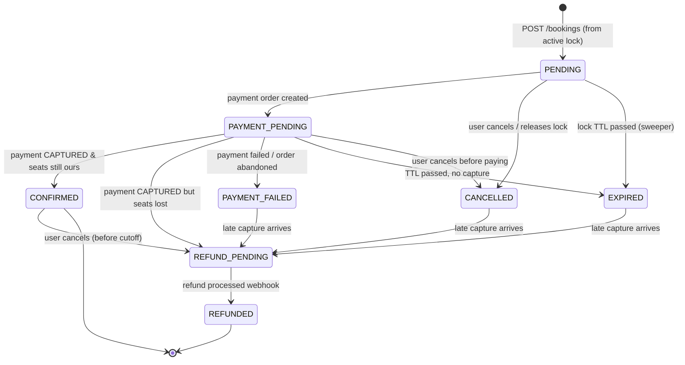

# CineBot — System Design (v0.1, for review)

Status: **REVIEWED 2026-11-03** — see §13 for decisions.
Scope: everything in Master Prompt §19 (requirements, ER model, state machine, seat locking, API contracts, module layout).

---

## 1. Functional Requirements

### 1.1 Customer
| ID | Requirement |
|----|-------------|
| FR-1 | Register, log in, refresh session (JWT access + rotating refresh token). |
| FR-2 | Browse movies (paginated), filter by genre / language / city with active shows, full-text-ish search by title. |
| FR-3 | View movie details (TMDB metadata served from **our** DB). |
| FR-4 | List theatres by city; view a theatre with its screens. |
| FR-5 | List shows by movie + city + date (+ optional time window, theatre). |
| FR-6 | View seat map for a show with live status (AVAILABLE / LOCKED / BOOKED / BLOCKED) and price per seat. |
| FR-7 | Lock 1–10 seats for a show for a fixed TTL (8 min). One active lock per user per show. |
| FR-8 | Release a lock voluntarily. |
| FR-9 | Create a pending booking from a lock; see summary (seats, price breakdown, expiry). |
| FR-10 | Pay via the simulated payment gateway; booking confirmed **only after server-side verification**. |
| FR-11 | Receive a ticket: unique booking reference + signed QR code. |
| FR-12 | View own booking history (paginated) and a single booking. |
| FR-13 | Cancel a booking: unpaid → released immediately; confirmed → refund flow (allowed until show start − 2h). |
| FR-14 | Chat with CineBot in natural language to search, pick shows, lock seats, and start payment. |

### 1.2 Admin
| ID | Requirement |
|----|-------------|
| FR-A1 | Trigger TMDB sync (now-playing / popular) and view sync status. |
| FR-A2 | CRUD theatres, screens, seat layouts (rows × columns, seat types). |
| FR-A3 | Schedule shows (movie, screen, start time, price per seat type). Overlapping shows on a screen are rejected. |
| FR-A4 | Dashboard: bookings per show, occupancy, revenue, failed/refund payments. |

### 1.3 System
| ID | Requirement |
|----|-------------|
| FR-S1 | Expired locks release seats automatically (lazy on read + sweeper job). |
| FR-S2 | Failed payments release seats. |
| FR-S3 | Payment reconciliation recovers "paid but not confirmed" bookings. |
| FR-S4 | Domain events published reliably via transactional outbox → Kafka. |
| FR-S5 | Notification / ticket / analytics consumers are idempotent. |

### 1.4 Out of scope (v1)
Food & beverage, coupons, dynamic pricing, multi-currency, seat-hold queues, real cinema integrations, SMS.

---

## 2. Non-Functional Requirements

| Area | Target / Rule |
|------|---------------|
| **Correctness** | Zero double-confirmed seats under any concurrency or partial failure. This outranks every other NFR. |
| Consistency | PostgreSQL is the single source of truth. Redis is an optimization, never an authority. |
| Availability | Redis down → booking still correct (DB-only path, higher latency). Kafka down → bookings still confirm; events wait in outbox. Gemini down → classic UI unaffected. |
| Latency (local, p95) | Catalog reads < 100 ms (cached); seat map < 150 ms; lock seats < 250 ms. |
| Load (initial) | 100 concurrent users; 20 users on the same seat → exactly 1 winner; 1,000 lock requests across different seats with 0 errors from contention. |
| Security | BCrypt passwords; short-lived JWT (15 min); refresh tokens hashed + rotated with reuse detection; ownership checks on every booking read; webhook HMAC verification; no secrets in repo. |
| Idempotency | Payment order creation, verification, webhooks, and Kafka consumers are all safe to repeat. |
| Observability | Structured JSON logs with `traceId`, `bookingId`; Actuator health (db, redis, kafka); Micrometer metrics (lock conflicts, confirm latency, outbox lag). |
| Data | Money stored as `BIGINT` paise. Timestamps `TIMESTAMPTZ` (UTC); business timezone `Asia/Kolkata` for "tonight" etc. |
| Maintainability | Modular monolith; modules talk via service interfaces, not each other's repositories. Flyway migrations only. |
| AI safety | LLM never touches DB, never decides availability, never assumes payment, cannot trigger payment without a human UI action. |

---

## 3. ER Diagram

Tables from the master prompt plus five supporting tables I recommend: `refresh_tokens`, `payment_webhook_events`, `outbox_events`, `processed_events`, `movie_sync_runs`. (Per-show pricing is folded into `show_seats.price_paise` — see note below.)

```mermaid
erDiagram
    users ||--o{ refresh_tokens : has
    users ||--o{ seat_locks : holds
    users ||--o{ bookings : places
    users ||--o{ chatbot_sessions : owns

    movies ||--o{ movie_genres : tagged
    genres ||--o{ movie_genres : tags
    movies ||--o{ shows : screened_in

    theatres ||--o{ screens : contains
    screens ||--o{ seats : has
    screens ||--o{ shows : hosts

    shows ||--o{ show_seats : inventory
    seats ||--o{ show_seats : instance_of
    seat_locks ||--o{ show_seats : currently_holds
    bookings ||--o{ show_seats : confirmed_by

    seat_locks ||--o| bookings : becomes
    shows ||--o{ bookings : for
    bookings ||--|{ booking_seats : contains
    show_seats ||--o{ booking_seats : referenced_by
    bookings ||--o{ payments : paid_by
    payments ||--o{ payment_webhook_events : receives

    chatbot_sessions ||--o{ chatbot_messages : contains

    users {
        bigint id PK
        varchar email UK
        varchar password_hash
        varchar full_name
        varchar phone
        varchar role "USER|ADMIN"
        timestamptz created_at
        timestamptz updated_at
    }
    refresh_tokens {
        bigint id PK
        bigint user_id FK
        char token_hash UK "SHA-256"
        uuid family_id "rotation chain"
        timestamptz expires_at
        timestamptz revoked_at
        timestamptz created_at
    }
    movies {
        bigint id PK
        bigint tmdb_id UK
        varchar title
        text overview
        varchar original_language
        date release_date
        int runtime_minutes
        varchar poster_path
        varchar backdrop_path
        numeric vote_average
        varchar certification
        boolean active
        timestamptz synced_at
    }
    genres {
        bigint id PK
        int tmdb_genre_id UK
        varchar name UK
    }
    movie_genres {
        bigint movie_id PK,FK
        bigint genre_id PK,FK
    }
    theatres {
        bigint id PK
        varchar name
        varchar brand "PVR, INOX..."
        varchar city
        varchar address
        numeric latitude
        numeric longitude
        boolean active
    }
    screens {
        bigint id PK
        bigint theatre_id FK
        varchar name "UK(theatre_id,name)"
        int total_seats
        varchar screen_type "2D|3D|IMAX"
    }
    seats {
        bigint id PK
        bigint screen_id FK
        varchar row_label "A..Z"
        int seat_number
        varchar seat_type "REGULAR|PREMIUM|RECLINER"
        boolean active
    }
    shows {
        bigint id PK
        bigint movie_id FK
        bigint screen_id FK
        timestamptz start_time
        timestamptz end_time
        varchar language
        varchar format
        varchar status "SCHEDULED|CANCELLED|COMPLETED"
    }
    show_seats {
        bigint id PK
        bigint show_id FK "UK(show_id,seat_id)"
        bigint seat_id FK
        bigint price_paise
        varchar status "AVAILABLE|LOCKED|BOOKED|BLOCKED"
        uuid lock_id FK "nullable"
        timestamptz locked_until
        bigint booking_id FK "set when BOOKED"
        bigint version
    }
    seat_locks {
        uuid id PK
        bigint user_id FK
        bigint show_id FK
        varchar status "ACTIVE|RELEASED|EXPIRED|CONSUMED"
        timestamptz expires_at
        timestamptz created_at
    }
    bookings {
        bigint id PK
        varchar booking_reference UK
        bigint user_id FK
        bigint show_id FK
        uuid seat_lock_id FK,UK
        varchar status
        bigint total_amount_paise
        varchar currency
        timestamptz expires_at
        timestamptz confirmed_at
        bigint version
        timestamptz created_at
    }
    booking_seats {
        bigint id PK
        bigint booking_id FK
        bigint show_seat_id FK
        bigint price_paise
        boolean confirmed "partial UK(show_seat_id) WHERE confirmed"
    }
    payments {
        bigint id PK
        bigint booking_id FK
        varchar provider "SIMULATED"
        varchar provider_order_id UK
        varchar provider_payment_id UK
        varchar provider_refund_id
        bigint amount_paise
        varchar status "CREATED|CAPTURED|FAILED|REFUND_PENDING|REFUNDED"
        varchar failure_reason
        int reconcile_attempts
        timestamptz created_at
        timestamptz updated_at
    }
    payment_webhook_events {
        varchar provider_event_id PK
        bigint payment_id FK
        varchar event_type
        jsonb payload
        timestamptz received_at
        timestamptz processed_at
    }
    chatbot_sessions {
        uuid id PK
        bigint user_id FK
        jsonb context "selected movie/show/lock ids"
        varchar status
        timestamptz created_at
        timestamptz last_active_at
    }
    chatbot_messages {
        bigint id PK
        uuid session_id FK
        varchar role "USER|MODEL|TOOL"
        text content
        varchar tool_name
        jsonb tool_payload
        timestamptz created_at
    }
```



Not drawn (no FKs to domain tables):

```
outbox_events(id uuid PK, aggregate_type, aggregate_id, event_type, payload jsonb,
              created_at, published_at NULL, attempts int, last_error)
processed_events(consumer_group varchar, event_id uuid, processed_at,  PK(consumer_group, event_id))
movie_sync_runs(id, started_at, finished_at, status, movies_upserted, error)
```

### 3.1 Key constraints & indexes

| Table | Constraint / Index | Why |
|-------|--------------------|-----|
| `show_seats` | `UNIQUE(show_id, seat_id)` | Exactly one inventory row per physical seat per show — **the core double-booking guard**: one row can only hold one `booking_id`. |
| `show_seats` | `CHECK (status <> 'BOOKED' OR booking_id IS NOT NULL)`, `CHECK (status <> 'LOCKED' OR (lock_id IS NOT NULL AND locked_until IS NOT NULL))` | State/column consistency enforced by DB, not just code. |
| `show_seats` | `INDEX(show_id, status)`, `INDEX(lock_id)` | Seat map, lock release. |
| `booking_seats` | `UNIQUE(show_seat_id) WHERE confirmed` (partial) | Defense in depth: even if code is wrong, two confirmed bookings can't reference the same show-seat. |
| `bookings` | `UNIQUE(seat_lock_id)` | One lock → at most one booking (idempotent `POST /bookings`). |
| `bookings` | `INDEX(user_id, created_at DESC)` | Booking history. |
| `bookings` | `INDEX(status, expires_at)` | Expiry sweeper. |
| `seat_locks` | `UNIQUE(user_id, show_id) WHERE status='ACTIVE'` | Anti-hoarding: one live lock per user per show. |
| `seat_locks` | `INDEX(status, expires_at)` | Sweeper. |
| `shows` | `EXCLUDE USING gist (screen_id WITH =, tstzrange(start_time, end_time) WITH &&) WHERE status <> 'CANCELLED'` (btree_gist) | DB-level guarantee no two shows overlap on one screen. |
| `shows` | `INDEX(movie_id, start_time)`, `INDEX(screen_id, start_time)` | Show search. |
| `theatres` | `INDEX(lower(city))` | City search. |
| `movies` | `UNIQUE(tmdb_id)`, `GIN(title gin_trgm_ops)` (pg_trgm) | Idempotent sync upserts; fuzzy title search ("intersteller"). |
| `seats` | `UNIQUE(screen_id, row_label, seat_number)` | No duplicate seat labels. |
| `payments` | `UNIQUE(provider_order_id)`, `UNIQUE(provider_payment_id)` | Webhook/verify dedup by provider IDs. |
| `payments` | `UNIQUE(booking_id) WHERE status IN ('CREATED','CAPTURED')` | At most one live order per booking. |
| `payment_webhook_events` | PK `provider_event_id` | Duplicate webhook → insert conflict → ignored. |
| `outbox_events` | `INDEX(created_at) WHERE published_at IS NULL` | Fast poll of unpublished events. |

**Pricing note:** Instead of a separate `show_pricing` table, the admin sends `{REGULAR: 20000, PREMIUM: 30000}` when creating a show, and the price is **snapshotted into `show_seats.price_paise`** at creation. Fewer joins on the hottest read path; price changes after booking can't corrupt history (booking_seats snapshot again). Trade-off: changing a show's price is a bulk update — acceptable.

---

## 4. Entity Relationships (summary)

- **Theatre 1—N Screen 1—N Seat** — physical, rarely changes.
- **Movie 1—N Show N—1 Screen** — a show is "movie X on screen Y at time T".
- **Show 1—N ShowSeat N—1 Seat** — per-show inventory generated when the show is created (`INSERT … SELECT FROM seats WHERE screen_id = ?`). This is what gets locked and booked; `seats` is never mutated by booking.
- **User 1—N SeatLock**; a SeatLock "holds" N ShowSeats via `show_seats.lock_id`. No join table needed — the lock is an attribute of the inventory row.
- **SeatLock 1—0..1 Booking** — a booking is created from a lock.
- **Booking 1—N BookingSeat N—1 ShowSeat** — immutable record of what was bought at what price.
- **Booking 1—N Payment** — usually 1; multiple if a failed order is followed by a refund record or a late duplicate capture.
- **ChatbotSession 1—N ChatbotMessage**; session `context` jsonb stores IDs (showId, lockId, bookingId), never PII/payment data.

JPA mapping policy: `@ManyToOne(fetch = LAZY)` everywhere, no bidirectional `@OneToMany` collections except where a module truly owns children (Booking→BookingSeat). No cascading across module boundaries.

---

## 5. Booking Lifecycle & State Machine



Implementation: a `BookingStatus` enum with `Set<BookingStatus> allowedNext()`; `Booking.transitionTo(next)` throws `InvalidStateTransitionException` (→ HTTP 409). Every transition happens inside a transaction holding `SELECT … FOR UPDATE` on the booking row, plus `@Version` as a second guard.

**Side effects per transition**

| Transition | Seats | Lock | Payment | Outbox event |
|-----------|-------|------|---------|--------------|
| → PENDING | stay LOCKED | ACTIVE | – | BookingCreated |
| → PAYMENT_PENDING | – | – | CREATED | – |
| → CONFIRMED | LOCKED → BOOKED, `booking_id` set; booking_seats.confirmed = true | CONSUMED | CAPTURED | BookingConfirmed (→ ticket + notification consumers) |
| → PAYMENT_FAILED / EXPIRED / CANCELLED | LOCKED → AVAILABLE (only rows still holding this `lock_id`) | RELEASED / EXPIRED | FAILED (if any) | PaymentFailed / BookingCancelled |
| → REFUND_PENDING | from CONFIRMED: BOOKED → AVAILABLE | – | REFUND_PENDING; refund API called | BookingCancelled |
| → REFUNDED | – | – | REFUNDED | – |

**Why PAYMENT_FAILED is terminal:** the checkout lets the user retry inside the same checkout, so a single `payment.failed` webhook does *not* fail the booking — we only move to PAYMENT_FAILED when the lock expires with failed attempts or the user abandons. Retrying after that means a fresh lock. Simpler state machine; slight UX cost.

---

## 6. Seat-Locking Strategy (the critical part)

### 6.1 Principle
**Two layers, one authority.**
1. **Redis** = fast admission filter. Rejects the 19 losers of a 20-way race in ~1 ms without touching Postgres.
2. **PostgreSQL** = authority. A conditional `UPDATE` decides who actually holds the seat. If Redis disagrees with Postgres, Postgres wins.

### 6.2 Acquire lock — `POST /seat-locks {showId, showSeatIds[]}`

```
1. Validate: show SCHEDULED, starts > now+15min, 1..10 seats, all belong to show.
2. Redis (best effort):
     Lua script, all-or-nothing:
       for each seat: if EXISTS seatlock:{showId}:{showSeatId} → return conflict
       for each seat: SET seatlock:{showId}:{showSeatId} {lockId} PX ttl
   - conflict → 409 SEATS_UNAVAILABLE (no DB hit)
   - Redis error/timeout (circuit breaker open) → log + continue to DB path
3. Postgres transaction (READ COMMITTED):
     a. expire caller's own stale ACTIVE lock for this show (anti-hoarding index)
     b. INSERT seat_locks(id=lockId, user, show, ACTIVE, expires_at=now()+8m)
     c. UPDATE show_seats
          SET status='LOCKED', lock_id=:lockId, locked_until=:expiresAt, version=version+1
        WHERE show_id=:showId AND id = ANY(:ids)
          AND (status='AVAILABLE' OR (status='LOCKED' AND locked_until < now()))
     d. if updatedRows != ids.length → ROLLBACK → 409 SEATS_UNAVAILABLE
4. On DB failure/rollback → Redis compare-and-delete our keys (Lua: del if value==lockId).
5. Return {lockId, expiresAt, seats, totalPaise}.
```

Why conditional `UPDATE` instead of `SELECT … FOR UPDATE` then `UPDATE`: one round trip, the row lock is taken and the predicate re-evaluated atomically by Postgres; under READ COMMITTED a concurrent winner causes the loser's predicate to fail on re-check → 0 rows → clean rejection. No deadlocks across multi-seat locks because the losing statement simply doesn't match; we still sort IDs to keep lock order deterministic.

The `OR (status='LOCKED' AND locked_until < now())` clause is **lazy expiry**: an expired lock is stealable immediately, even if the sweeper hasn't run. The sweeper is cleanup, not a correctness dependency.

### 6.3 Confirm booking (after payment captured)

```
TX:
  SELECT * FROM bookings WHERE id=:id FOR UPDATE
  if CONFIRMED                → return (idempotent)
  if PENDING|PAYMENT_PENDING  →
      SELECT * FROM show_seats WHERE id = ANY(:ids) ORDER BY id FOR UPDATE
      if every row: status='LOCKED' AND lock_id=:booking.lockId     -- expiry NOT checked
          UPDATE show_seats SET status='BOOKED', booking_id=:id, lock_id=NULL, locked_until=NULL
          UPDATE booking_seats SET confirmed=true
          booking → CONFIRMED; lock → CONSUMED; payment → CAPTURED
          INSERT outbox BookingConfirmed
      else
          booking → REFUND_PENDING; INSERT outbox RefundRequested
  if EXPIRED|PAYMENT_FAILED|CANCELLED → REFUND_PENDING
COMMIT
```

### 6.4 Race: lock expiry vs payment confirmation
- We check **ownership (`lock_id`)**, not the clock, at confirm time. If the lock expired but nobody stole the seats, the late payer still gets their seats — best outcome.
- If someone stole them (they ran the conditional update after expiry), `lock_id` differs → we refund. A seat is never given to two people because only one `lock_id` can occupy the row.
- Sweeper vs confirm: both take `FOR UPDATE` on the booking row; whoever commits first wins, the other re-reads state and follows the table above. Sweeper also **skips bookings with a CAPTURED payment** (reconciler owns those).
- Payment orders expire after 6 min, before the 8 min lock TTL, so late captures are rare by design and handled by refund when they do happen.

### 6.5 Redis failure modes
| Failure | Effect | Correct? |
|---------|--------|---------|
| Redis down | Breaker opens, DB path only, more DB contention | ✅ |
| Redis key expires before DB lock | Another user passes Redis, DB conditional update rejects (DB lock still valid) | ✅ |
| Redis key exists but DB lock rolled back (crash between steps) | Seat looks taken in Redis until TTL; worst case a false "unavailable" for ≤8 min. Seat map reads from DB, so UI still shows available. | ✅ (availability cost only) |
| Redis flushed | Same as down | ✅ |

### 6.6 Release
`DELETE /seat-locks/{id}` (owner only) and sweeper: `UPDATE show_seats SET status='AVAILABLE', lock_id=NULL … WHERE lock_id=:id AND status='LOCKED'` + Redis compare-and-delete. Scoping by `lock_id` means a release can never free someone else's seat.

---

## 7. Payment Design (preview — implemented Week 5)

**Decision (review 2026-11-03): no real payment provider.** Payments use a **simulated gateway** that behaves like Razorpay (orders, payment IDs, HMAC-signed callbacks and webhooks, refunds), so every reliability problem stays real and testable: signature checks, duplicate webhooks, idempotency, crash recovery.

```
PaymentGateway (interface)            <- booking/payment code depends only on this
 └── SimulatedPaymentGateway          <- in-process "provider" with its own table/state + HMAC secret
```

- `POST /payments/orders {bookingId}` → idempotent: returns the existing CREATED order for the booking if there is one, otherwise `gateway.createOrder(amount from DB, receipt=bookingReference)`. The amount never comes from the client.
- **Mock checkout page** (frontend) shows the order with **Pay** / **Fail** buttons → `POST /payments/simulate {orderId, outcome: SUCCESS|FAILURE}` (enabled only when `cinebot.payment.simulator.enabled=true`). The simulator:
  1. records the provider-side payment (`pay_xxx`, CAPTURED or FAILED),
  2. returns a callback `{orderId, paymentId, signature = HMAC_SHA256(orderId|paymentId, secret)}` to the frontend,
  3. **asynchronously** POSTs a signed webhook to `/payments/webhook`, optionally delivered twice or delayed (config flags) to exercise duplicate handling.
- `POST /payments/verify {orderId, paymentId, signature}` → verify HMAC, then **ask the gateway for the payment status** (never trust the callback alone), then confirm (6.3).
- `POST /payments/webhook` → verify `X-Cinebot-Signature` over the raw body; insert into `payment_webhook_events` (PK conflict → 200, ignored); handle `payment.captured`, `payment.failed`, `refund.processed`.
- **Implemented in Step 5 with one refinement (see docs/05-payments.md):** capture + confirmation commit in ONE transaction; the provider's durable record + webhook retries + reconciler recover a crash. Failed payment = booking PAYMENT_FAILED and seats released at once.
- **Crash after capture, before confirm:** a fault-injection flag makes confirmation throw after the payment is marked CAPTURED. The **reconciler** (every minute) picks CREATED payments older than 2 min, or CAPTURED payments whose booking isn't final, asks the gateway, and runs confirm again. Verify, webhook and reconciler all go through the same idempotent `BookingConfirmationService.confirm(bookingId, providerPaymentId)`.
- Refunds: `gateway.refund(paymentId)` → simulator emits `refund.processed` webhook → REFUND_PENDING → REFUNDED.
- Swapping in real Razorpay later = one new `PaymentGateway` implementation; no booking code changes.

---

## 8. Events & Kafka (preview — Week 6)

> **Superseded (2026-11-04, ADR-10):** implemented as a transactional outbox with in-process handlers, **without Kafka**. See docs/06-events-outbox.md. The original Kafka plan is kept below for reference.


Outbox row written in the same DB transaction as the state change → `OutboxPublisher` polls (`FOR UPDATE SKIP LOCKED`, batch 100) → Kafka topic `cinebot.bookings` / `cinebot.payments`, key = bookingId (per-booking ordering) → marks `published_at`.
Consumers (separate groups): `ticket-service`, `notification-service`, `analytics-service`. Each inserts `(group, eventId)` into `processed_events` in the same transaction as its side effect → duplicates are no-ops. Retries: 3 with backoff via `DefaultErrorHandler`, then `*.DLT`.

Kafka is **not** used in the synchronous lock/book/pay path.

---

## 9. Chatbot Safety Model (preview — Weeks 7–8)

- Gemini receives tool declarations; the backend executes tools **as the authenticated user** via the same services the REST controllers use. Tool args are validated like request DTOs.
- Tool results are compact DTOs (ids, titles, times, seat labels, prices) — no email, phone, payment IDs.
- `initiatePayment` tool **does not create a payment**. It returns a `PAYMENT_CONFIRMATION_REQUIRED` card (bookingId, amount, expiry). The UI shows a "Confirm & Pay ₹500" button; only that **human click** calls `POST /payments/orders` and opens the mock checkout. So even a jailbroken model can't pay.
- Session `context` stores current `showId/lockId/bookingId` so "select A1 and A2" resolves seat labels → `showSeatIds` server-side.

---

## 10. REST API Contracts (v1)

Conventions:
- Base `/api/v1`, JSON, `Authorization: Bearer <access>`.
- Errors: RFC 7807 `application/problem+json`:
  ```json
  {"type":"https://cinebot.dev/errors/seats-unavailable","title":"Seats unavailable","status":409,
   "detail":"2 of 2 seats are no longer available","code":"SEATS_UNAVAILABLE",
   "traceId":"…","errors":[{"field":"showSeatIds","message":"…"}]}
  ```
- Pagination: `?page=0&size=20&sort=startTime,asc` → `{"content":[…],"page":0,"size":20,"totalElements":134,"totalPages":7}`
- Rate limits (Redis): `/auth/login` 10/min/IP, `/seat-locks` 20/min/user, `/chat/messages` 30/min/user → 429.

### 10.1 Auth (public)
| Method | Path | Body | 2xx | Errors |
|--|--|--|--|--|
| POST | `/auth/register` | `{email, password, fullName, phone?}` | 201 `{user, accessToken, refreshToken, expiresIn}` | 400, 409 EMAIL_TAKEN |
| POST | `/auth/login` | `{email, password}` | 200 same | 401 INVALID_CREDENTIALS, 429 |
| POST | `/auth/refresh` | `{refreshToken}` | 200 new pair (old revoked) | 401 (reuse → whole family revoked) |
| POST | `/auth/logout` | `{refreshToken}` | 204 | – |

### 10.2 Catalog (public)
| Method | Path | Params | Response |
|--|--|--|--|
| GET | `/movies` | `city?, genre?, language?, nowShowing?, page, size` | Page<MovieSummary{id,title,posterUrl,genres,language,rating}> |
| GET | `/movies/{id}` | – | MovieDetail (+ runtime, overview, backdrop, releaseDate) |
| GET | `/movies/search` | `q` (min 2), `page,size` | Page<MovieSummary> (trigram match) |
| GET | `/genres` | – | `[{id,name}]` |
| GET | `/theatres` | `city` (required), `brand?`, `page,size` | Page<TheatreSummary> |
| GET | `/theatres/{id}` | – | TheatreDetail + screens |
| GET | `/shows` | `movieId?, city?, theatreId?, date (yyyy-MM-dd)?, from? (HH:mm), to?` | `[{showId, startTime, format, language, theatre{id,name}, screen, minPricePaise, availableSeats}]` |
| GET | `/shows/{id}/seats` | – | `{showId, rows:[{label:"A", seats:[{showSeatId, number, type, pricePaise, status}]}]}` (status from DB; expired locks reported AVAILABLE) |

### 10.3 Booking (auth: USER)
| Method | Path | Body | 2xx | Errors |
|--|--|--|--|--|
| POST | `/seat-locks` | `{showId, showSeatIds[1..10]}` | 201 `{lockId, expiresAt, seats[], totalPaise}` | 400, 404 SHOW_NOT_FOUND, 409 SEATS_UNAVAILABLE, 422 SHOW_CLOSED |
| DELETE | `/seat-locks/{lockId}` | – | 204 | 403, 404, 409 LOCK_ALREADY_USED |
| POST | `/bookings` | `{lockId}` | 201 BookingResponse (PENDING); repeat call → 200 same booking | 404, 409 LOCK_EXPIRED / LOCK_ALREADY_USED, 403 |
| GET | `/bookings/{id}` | – | BookingResponse `{id, reference, status, show{…}, seats[], totalPaise, expiresAt, ticket?{qrPayload}}` | 403 (not owner), 404 |
| GET | `/bookings/my` | `status?, page, size` | Page<BookingSummary> | – |
| POST | `/bookings/{id}/cancel` | `{reason?}` | 200 BookingResponse (CANCELLED or REFUND_PENDING) | 409 INVALID_TRANSITION / CANCELLATION_WINDOW_CLOSED |

> Note: 403 vs 404 for another user's booking — I recommend **404** (don't leak existence). Decide in review.

### 10.4 Payments
| Method | Path | Auth | Body | 2xx |
|--|--|--|--|--|
| POST | `/payments/orders` | USER | `{bookingId}` | 201/200 `{orderId, amountPaise, currency, expiresAt}` |
| POST | `/payments/verify` | USER | `{orderId, paymentId, signature}` | 200 BookingResponse (CONFIRMED or REFUND_PENDING) — 400 bad signature |
| POST | `/payments/webhook` | signature | raw provider payload | 200 always after signature OK (even duplicates) |
| POST | `/payments/simulate` | USER (simulator only) | `{orderId, outcome}` | 200 `{orderId, paymentId, signature}` |

### 10.5 Chat (auth: USER)
| Method | Path | Body | 2xx |
|--|--|--|--|
| POST | `/chat/sessions` | `{}` | 201 `{sessionId}` |
| POST | `/chat/messages` | `{sessionId, message}` | 200 `{reply, cards:[{type:"MOVIES"\|"SHOWS"\|"SEAT_MAP"\|"LOCK_SUMMARY"\|"PAYMENT_CONFIRMATION_REQUIRED"\|"TICKET", data}]}` |
| GET | `/chat/sessions/{id}` | – | `{sessionId, messages:[{role, content, cards, createdAt}]}` |

### 10.6 Admin (auth: ADMIN)
`POST /admin/movies/sync`, `GET /admin/movies/sync-runs`, `POST|PUT /admin/theatres`, `POST /admin/theatres/{id}/screens`, `PUT /admin/screens/{id}/layout {rows:[{label, seats:[{number,type}]}]}`, `POST /admin/shows {movieId, screenId, startTime, language, format, prices:{REGULAR:20000,…}}`, `POST /admin/shows/{id}/cancel`, `GET /admin/stats/shows/{id}`, `GET /admin/stats/revenue?from&to`.

---

## 11. Backend Module Structure

Single Maven module (multi-module Maven adds build friction without benefit at this size); boundaries enforced by package convention and an **ArchUnit test** (e.g. `booking` may not import `payment..repository`).

```
backend/
├── pom.xml
├── src/main/java/com/cinebot/
│   ├── CineBotApplication.java
│   ├── common/          # ApiError, GlobalExceptionHandler, PageResponse, BaseEntity, Clock config, ids
│   ├── config/          # SecurityConfig, OpenApiConfig, RedisConfig, KafkaConfig, JacksonConfig
│   ├── auth/            # AuthController, AuthService, JwtService, JwtAuthFilter, RefreshToken*
│   ├── user/            # User entity, UserRepository, UserService, Role
│   ├── movie/           # Movie, MovieController, MovieService, tmdb/ (TmdbClient, MovieSyncService)
│   ├── genre/           # Genre, GenreRepository, GenreController
│   ├── theatre/         # Theatre*, admin controller
│   ├── screen/          # Screen, Seat (physical), layout service
│   ├── show/            # Show, ShowController, ShowService, ShowSeatGenerator
│   ├── seat/            # ShowSeat, SeatLock, SeatLockService, RedisSeatLockGate, LockSweeper
│   ├── booking/         # Booking, BookingStatus(state machine), BookingService, BookingConfirmationService
│   ├── payment/         # Payment, PaymentGateway + SimulatedPaymentGateway, WebhookController, Reconciler
│   ├── outbox/          # OutboxWriter, OutboxProcessor (relay), EventHandler   (shared infra)
│   ├── notification/    # NotificationHandler (outbox consumer), EmailSender
│   ├── analytics/       # SalesAnalyticsHandler (outbox consumer), admin stats
│   └── chatbot/         # ChatController, ChatOrchestrator, GeminiClient, tools/ (one class per tool)
│   (each module: controller/ service/ repository/ entity/ dto/ — flattened when a module is tiny)
├── src/main/resources/
│   ├── application.yml, application-dev.yml, application-prod.yml
│   └── db/migration/V1__… V2__…
└── src/test/java/com/cinebot/...   # unit, @DataJpaTest, Testcontainers IT, concurrency tests
frontend/   # React + TS + Tailwind (Vite)
infra/      # docker-compose.yml, k6/ scripts
docs/       # this file, ADRs, Postman collection
```

Cross-module rule: modules call each other's **service** interfaces with DTOs/IDs; never another module's repository or entity mutation. Exception: `booking` reads `ShowSeat` via `seat` module's service.

---

## 12. Architecture Decisions (short ADRs)

| # | Decision | Alternatives | Why |
|---|----------|--------------|-----|
| ADR-1 | Modular monolith, single Maven module + ArchUnit | Microservices; Maven multi-module | Booking needs ACID across seats/booking/payment; one DB transaction beats sagas. ArchUnit gives boundaries cheaply. |
| ADR-2 | DB conditional UPDATE is the lock authority; Redis is an admission filter | Redis-only (Redlock); pessimistic `FOR UPDATE` only | Redis-only can't guarantee correctness on failover; DB-only is correct but hot rows serialize. Both = correct + fast. |
| ADR-3 | Confirm checks lock ownership, not wall-clock expiry | Strict expiry check | Gives late payers their seats when no one else took them; still single-owner. |
| ADR-4 | Transactional outbox + polling publisher | Publish to Kafka inside tx; Debezium CDC | Dual-write problem avoided; polling is simpler than CDC to run locally and explain. |
| ADR-5 | Refresh tokens opaque + hashed in DB with rotation | Stateless refresh JWT | Revocable, reuse detection; logout works. |
| ADR-6 | Price snapshot on show_seats | show_pricing table | Hot read path, immutable history. |
| ADR-7 | Payment authorized by human UI action, not LLM | LLM calls payment tool after "yes" | Prompt injection can fake a "yes"; a click can't be faked by the model. |
| ADR-9 | Simulated payment gateway behind a `PaymentGateway` interface | Razorpay test mode | User decision: manual/fake payments. Keeps signatures, webhooks, idempotency and reconciliation real while removing an external account dependency. |
| ADR-10 | Transactional outbox + in-process relay; **no Kafka** | Outbox → Kafka; direct publish | User decision: no use case for a broker yet (one deployable, few consumers). Outbox gives atomicity, retries, idempotent consumers and a clean path to Kafka later. |
| ADR-8 | Long IDs internally; UUID for locks/sessions/events | UUID everywhere | Locks/events are generated before insert (Redis value, idempotency). Bookings exposed via `booking_reference` for humans. |

---

## 13. Review Decisions (2026-11-03)

1. Java 21 (Temurin 21 installed locally) ✅
2. Another user's booking → **404** ✅
3. Lock TTL 8 min, max 10 seats, cancel cutoff 2h ✅
4. Extra tables + price snapshot on `show_seats` ✅
5. Payments are **simulated**, not Razorpay (see §7, ADR-9). PAYMENT_FAILED stays terminal (retry = new lock).

<details><summary>Original questions</summary>


1. **Java version:** your machine has **JDK 23**; spec says 21. I'll set `<release>21</release>` (compiles fine on 23). Install Temurin 21 later for exact parity — OK?
2. **Foreign booking access:** 404 (recommended) or 403?
3. **Lock TTL 8 min / max 10 seats / cancel cutoff 2h before show** — acceptable defaults?
4. **Extra tables** (`refresh_tokens`, `payment_webhook_events`, `outbox_events`, `processed_events`, `movie_sync_runs`) and dropping a separate pricing table — agreed?
5. **PAYMENT_FAILED as terminal** (retry = new lock) — agreed?
</details>

---

## 14. Next Step (after your review)

**Implementation Step 1 — Project setup + Authentication module**
- `backend/` Spring Boot 3.x, Java 21, Maven; dependencies: web, validation, security, data-jpa, postgres, flyway, actuator, springdoc, jjwt, testcontainers.
- `infra/docker-compose.yml` with Postgres only (Redis added in Week 4 with seat locking, Kafka in Week 6, each when it has a use).
- `V1__users_and_refresh_tokens.sql`.
- Register / login / refresh / logout, JWT filter, BCrypt, global RFC 7807 handler.
- Tests: `JwtServiceTest`, `AuthServiceTest` (Mockito), `AuthControllerIT` (Testcontainers Postgres) incl. refresh-token reuse detection.
